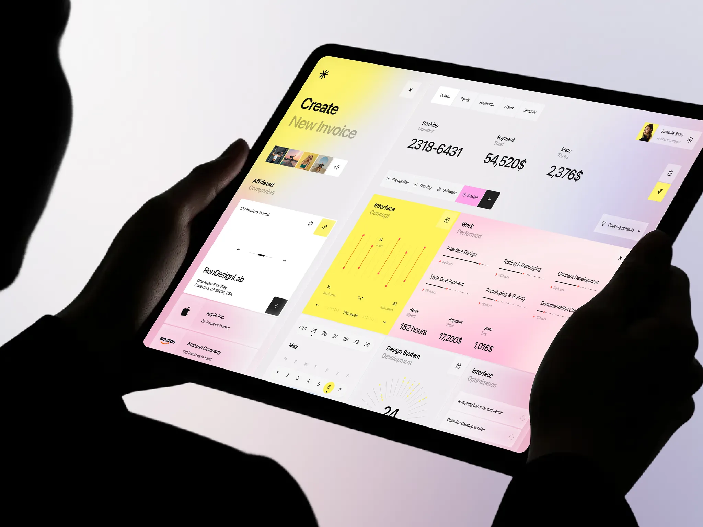

# Eilo｜黄粉大色块、规整分区与紧凑排版

来源：[Eilo - Finance managment Dashboard UI](https://dribbble.com/shots/27826935-Eilo-Finance-managment-Dashboard-UI)；页面署名：Jack R. for RonDesignLab；查阅日期：2026-10-23。

本页为查阅当日的观察记录；下方提供随包图片，原作链接用于核对出处。

## 看到的设计

- 浅灰紫底承接黄色趋势区和粉色工作区，两个大色块并列，左侧再以白卡承载客户信息；颜色、面积与内容组织一起形成主次。
- 数字明显大于指标名称，标签的第二行较轻；图表大量使用细黑线、红色端点和少量刻度，信息并不依赖厚重卡片边框。
- 顶部汇总、左侧对象列表、右侧分类内容构成稳定框架；黄、粉也出现在小标签和选中项中，连接不同分区。

## 可以怎么用

适合账单、项目进度、运营工作台。先确定对象区、汇总区、任务区，再让较大的彩色区域承载关键内容。

## 落地时要调整

中文标签加长后要重新确定列宽和行距；细线和浅色字需按实际屏幕检验。色值、字体和间距没有源码依据，不能称为原作设计变量。

## 随包素材

[图 01](01.webp) · [图 02](02.webp) · [图 03](03.webp) · [图 04](04.webp) · [图 05](05.webp) · [图 06](06.webp) · [图 07](07.webp) · [图 08](08.webp)

## 来源与范围

本包保存观察笔记、原作链接及原始媒体，供跨设备查看；素材权利归原作者，不适用本仓 MIT 许可。查阅当日未发现公开的 Figma 或源码下载入口；静态展示及产品能力、增长数字不作为真实业务验证结果。具体颜色与实现参数需要按采用项目重新确定。

[返回作品索引](../../README.md) · [设计经验与复用指南](../../设计经验与复用指南.md)
