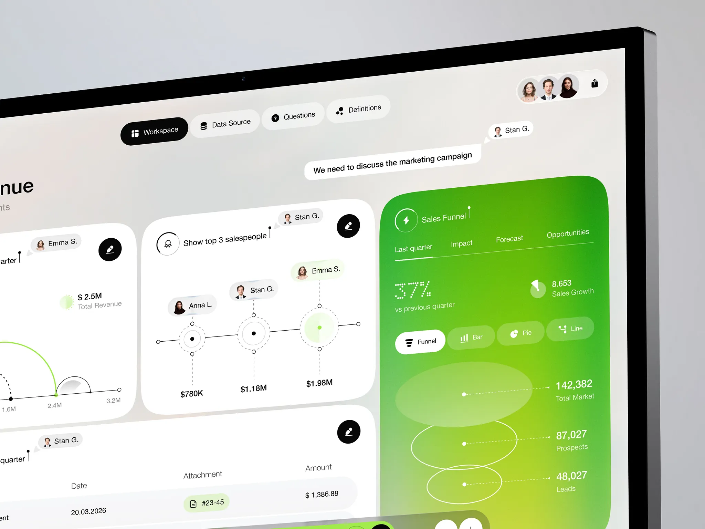

# Velto｜亮绿重点区、白色分析卡和就地协作

来源：[Velto — Collaborative Revenue Desktop App](https://dribbble.com/shots/27808845-Velto-Collaborative-Revenue-Desktop-App)；页面署名：Jack R. for RonDesignLab；查阅日期：2026-10-23。

本页为查阅当日的观察记录；下方提供随包图片，原作链接用于核对出处。

## 看到的设计

- 浅灰底上的白色卡片承担常规分析，右侧纵向亮绿漏斗区成为视觉重点；黑色圆形编辑控件提供稳定的高对比锚点。
- 头像与姓名以胶囊连接到图表节点，旁边有提问和批注；协作内容围绕具体数据展开，而非另开一整片聊天区。
- 顶部导航、图表格式切换和底部输入栏使用不同尺度的胶囊，图表主体仍以细线和数字留出空间。

## 可以怎么用

适合多人查看的经营看板、数据问答和分析评审。可借鉴“批注靠近对象、详情在当前上下文展开”。

## 落地时要调整

图中漏斗椭圆属于视觉表达，真实数据应采用明确比例并标注口径；多人批注不能遮住关键数值，底部输入栏需要预留空间。

## 随包素材

[图 01](01.webp) · [图 02](02.webp) · [图 03](03.webp) · [图 04](04.webp) · [图 05](05.webp) · [图 06](06.webp) · [图 07](07.webp)

## 来源与范围

本包保存观察笔记、原作链接及原始媒体，供跨设备查看；素材权利归原作者，不适用本仓 MIT 许可。查阅当日未发现公开的 Figma 或源码下载入口；静态展示及产品能力、增长数字不作为真实业务验证结果。具体颜色与实现参数需要按采用项目重新确定。

[返回作品索引](../../README.md) · [设计经验与复用指南](../../设计经验与复用指南.md)
