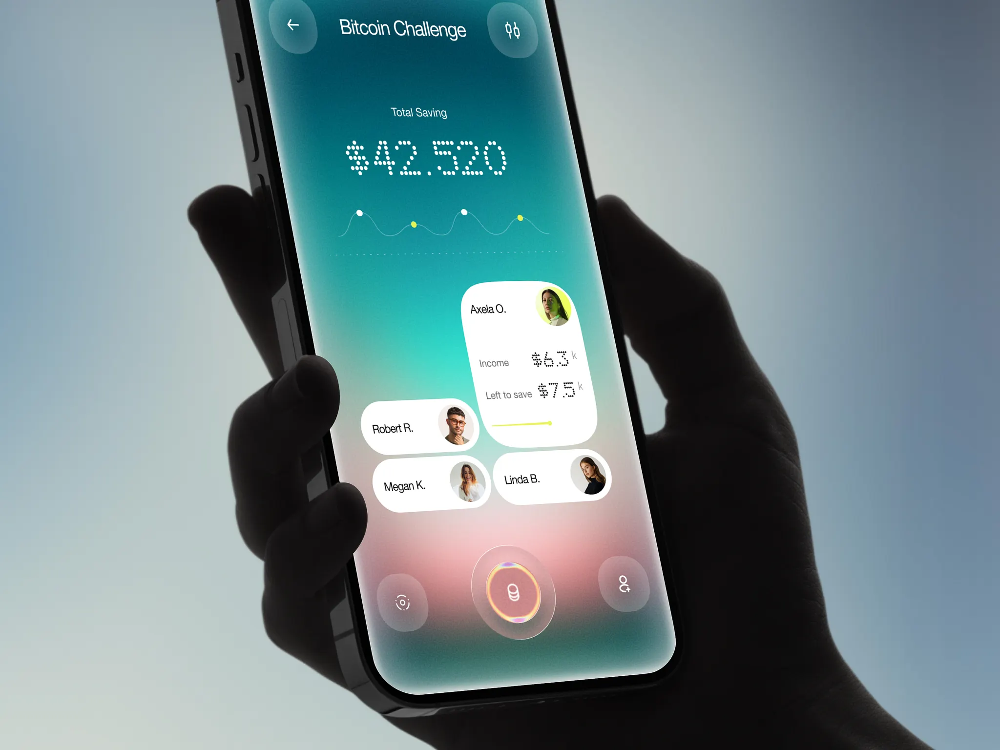

# Personal Assistant｜冷暖背景、大小不一的人物卡与突出主操作

来源：[Personal Assistant — AI Companion Mobile App UI](https://dribbble.com/shots/27811943-Personal-Assistant-AI-Companion-Mobile-App-UI)；页面署名：RonDesignLab；查阅日期：2026-10-23。

本页为查阅当日的观察记录；下方提供随包图片，原作链接用于核对出处。

## 看到的设计

- 画面由上部深青绿过渡到中下部柔粉，再回到深青色底边，白色人物胶囊与信息卡保持清晰轮廓。
- 展开的人物卡高于相邻收起胶囊，大小差异直接显示当前关注对象；上部总额与小趋势、下部人物组和主操作分层排列。
- 底部中心圆形控件比两侧按钮更大，环形高光集中在此；点阵数字增加识别特征，但并未用于整段正文。

## 可以怎么用

适合移动 AI 助手、人员概览和轻量任务入口。可尝试背景营造氛围、正文卡保持可靠对比，并用尺寸表达选中关系。

## 落地时要调整

页面标题是 AI 助手，实际样图显示储蓄挑战场景；只据图片判断视觉结构。语音、记忆和金融能力都未实测，点阵数字不宜直接用于密集指标。

## 随包素材

[图 01](01.webp) · [图 02](02.webp) · [图 03](03.webp) · [图 04](04.webp) · [图 05](05.webp) · [图 06](06.webp)

## 来源与范围

本包保存观察笔记、原作链接及原始媒体，供跨设备查看；素材权利归原作者，不适用本仓 MIT 许可。查阅当日未发现公开的 Figma 或源码下载入口；静态展示及产品能力、增长数字不作为真实业务验证结果。具体颜色与实现参数需要按采用项目重新确定。

[返回作品索引](../../README.md) · [设计经验与复用指南](../../设计经验与复用指南.md)
