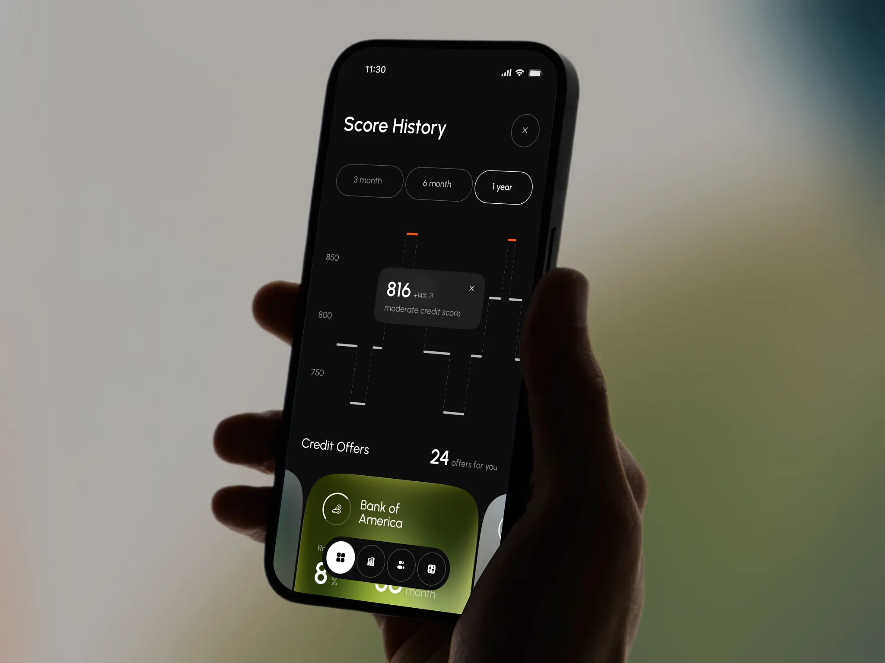

# Credit Karma｜黑灰层级、细线评分与局部橄榄绿光感

来源：[Credit Karma — Credit Monitoring Mobile App](https://dribbble.com/shots/27805340-Credit-Karma-Credit-Monitoring-Mobile-App)；页面署名：RonDesignLab；查阅日期：2026-10-23。

本页为查阅当日的观察记录；下方提供随包图片，原作链接用于核对出处。

## 看到的设计

- 黑色底、炭灰解释浮层和白色数据形成几层明度，局部橄榄绿卡片承担产品重点。
- 评分与历史趋势采用轻细线条、分段标记和周期胶囊；重点并不依靠大量粗边框或阴影。
- 底部工具组以白色选中圆形区别于深色按钮，强对比集中在当前入口。

## 可以怎么用

适合作为深色阅读、状态面板和数值解释的参考；也可只提取明度层级用于浅色界面。

## 落地时要调整

图中部分灰字较轻，真实屏幕需要提高可读性。用户对这组的整体喜好不等于要求现有浅色项目切为深色。

## 随包素材

[图 01](01.webp) · [图 02](02.webp) · [图 03](03.webp) · [图 04](04.webp) · [图 05](05.webp) · [图 06](06.webp)

## 来源与范围

本包保存观察笔记、原作链接及原始媒体，供跨设备查看；素材权利归原作者，不适用本仓 MIT 许可。查阅当日未发现公开的 Figma 或源码下载入口；静态展示及产品能力、增长数字不作为真实业务验证结果。具体颜色与实现参数需要按采用项目重新确定。

[返回作品索引](../../README.md) · [设计经验与复用指南](../../设计经验与复用指南.md)
