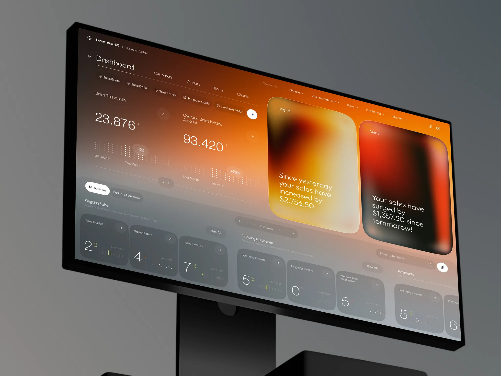

# Dynamic365｜橙铜色大背景、纵向洞察卡和下部紧凑指标

来源：[Dynamic365 - Financial Management Desktop](https://dribbble.com/shots/27771710-Dynamic365-Financial-Management-Desktop)；页面署名：Jack R. for RonDesignLab；查阅日期：2026-10-23。

本页为查阅当日的观察记录；下方提供随包图片，原作链接用于核对出处。

## 看到的设计

- 整体从橙铜色上部过渡到灰色下部；上部大数字和两张纵向洞察卡、下部横排活动卡形成明显的尺度变化。
- 销售与逾期金额并排，数字下面用点阵、短标签显示比较；右侧暖色玻璃卡承载较完整的文字结论。
- 洞察卡与下方活动卡使用不同材质和明度，卡片样式服从信息作用。

## 可以怎么用

适合关键结论、周报概览和需要突出洞察的首页。可以学习“数据、结论、行动”三个区域的尺度分配。

## 落地时要调整

全屏暖色和透色是该作品的具体选择；长时间高密度工作场景应单独验证。洞察必须能追溯数据，不能复制样图文案及营销增长数字。

## 随包素材

[图 01](01.webp) · [图 02](02.webp) · [图 03](03.webp) · [图 04](04.webp) · [图 05](05.webp) · [图 06](06.webp) · [图 07](07.webp) · [图 08](08.webp)

## 来源与范围

本包保存观察笔记、原作链接及原始媒体，供跨设备查看；素材权利归原作者，不适用本仓 MIT 许可。查阅当日未发现公开的 Figma 或源码下载入口；静态展示及产品能力、增长数字不作为真实业务验证结果。具体颜色与实现参数需要按采用项目重新确定。

[返回作品索引](../../README.md) · [设计经验与复用指南](../../设计经验与复用指南.md)
