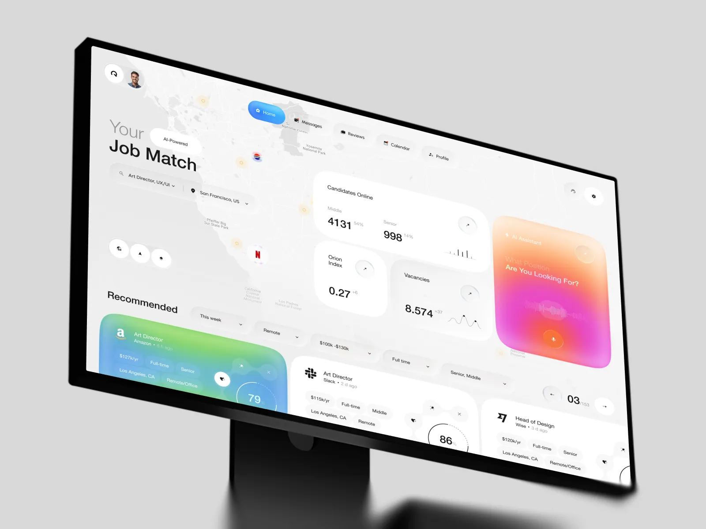

# Orion｜地图背景、蓝绿推荐项与粉橙 AI 区的冷暖配合

来源：[Orion - Job Search Desktop UI](https://dribbble.com/shots/27771667-Orion-Job-Search-Desktop-UI)；页面署名：Jack R. for RonDesignLab；查阅日期：2026-10-23。

本页为查阅当日的观察记录；下方提供随包图片，原作链接用于核对出处。

## 看到的设计

- 浅灰地图承担低对比背景，左侧大标题和搜索、中部统计群、右侧粉橙 AI 卡各有独立重心。
- 推荐职位中突出项使用青蓝绿渐变，其余项维持白色；连续列表与上方非等分布局共存。
- 导航与筛选用较小胶囊，关键数字用较大字号；不规则卡边与圆角带来细节变化，但区域仍可快速辨认。

## 可以怎么用

适合资源发现、人员搜索、课程选择和 AI 辅助推荐页。可以把搜索入口、结果与 AI 提示放在相邻区域。

## 落地时要调整

地图只有承载空间信息时才有业务价值；匹配百分比需要定义与依据。普通结果不能因为视觉强调变成不透明的推荐排序。

## 随包素材

[图 01](01.webp) · [图 02](02.webp) · [图 03](03.webp) · [图 04](04.webp) · [图 05](05.webp) · [图 06](06.webp) · [图 07](07.webp)

## 来源与范围

本包保存观察笔记、原作链接及原始媒体，供跨设备查看；素材权利归原作者，不适用本仓 MIT 许可。查阅当日未发现公开的 Figma 或源码下载入口；静态展示及产品能力、增长数字不作为真实业务验证结果。具体颜色与实现参数需要按采用项目重新确定。

[返回作品索引](../../README.md) · [设计经验与复用指南](../../设计经验与复用指南.md)
