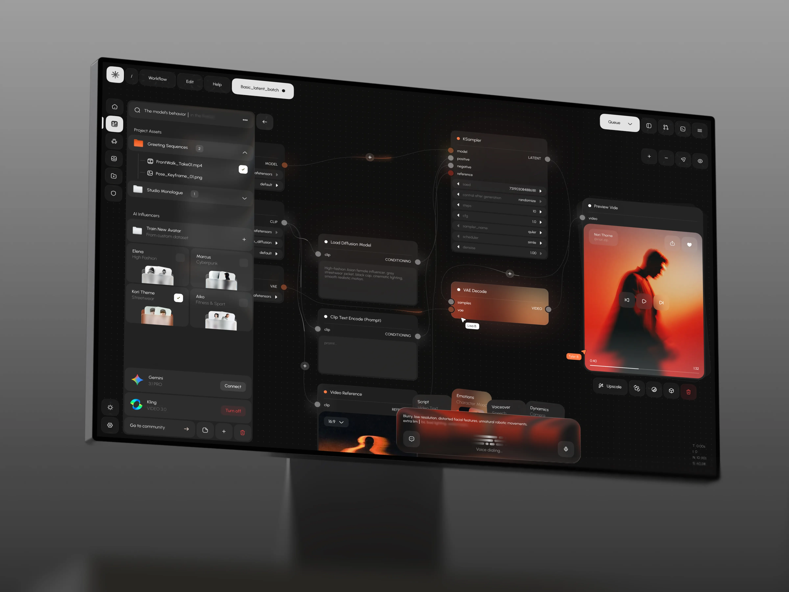

# Kvant AI｜暗色节点画布、邻近预览和内容驱动的红橙光感

来源：[Kvant AI – Video Generation Dashboard UI](https://dribbble.com/shots/27759263-Kvant-AI-Video-Generation-Dashboard-UI)；页面署名：Jack R. for RonDesignLab；查阅日期：2026-10-23。

本页为查阅当日的观察记录；下方提供随包图片，原作链接用于核对出处。

## 看到的设计

- 桌面图左侧保留素材库，中间节点连接，右侧成品预览，下方输入区；过程与结果在同一视野内。
- 红橙色主要来自视频内容与选中节点，黑灰工具层保持相对稳定；点阵画布和细连线提供组织背景。
- 移动图展示剪辑时间轴。主视频约 9.33 秒，实际观察到节点特写切换为移动视频预览，是剪辑展示而非真实操作录屏验收。

## 可以怎么用

适合创作工具、Agent 实验环境和需要核对中间结果的流程界面。可借鉴素材、过程、结果的空间关系。

## 落地时要调整

不能因视觉吸引力强就把普通业务流程全部改成节点编辑器。运行、失败、重试与结果来源需要在真实产品中另行设计。

## 随包素材

[图 01](01.webp) · [图 02](02.webp) · [图 03](03.webp) · [图 04](04.webp)

[展示视频](展示视频.mp4) · 在[看图库](../../index.html)中播放

## 来源与范围

本包保存观察笔记、原作链接及原始媒体，供跨设备查看；素材权利归原作者，不适用本仓 MIT 许可。查阅当日未发现公开的 Figma 或源码下载入口；静态展示及产品能力、增长数字不作为真实业务验证结果。具体颜色与实现参数需要按采用项目重新确定。

[返回作品索引](../../README.md) · [设计经验与复用指南](../../设计经验与复用指南.md)
