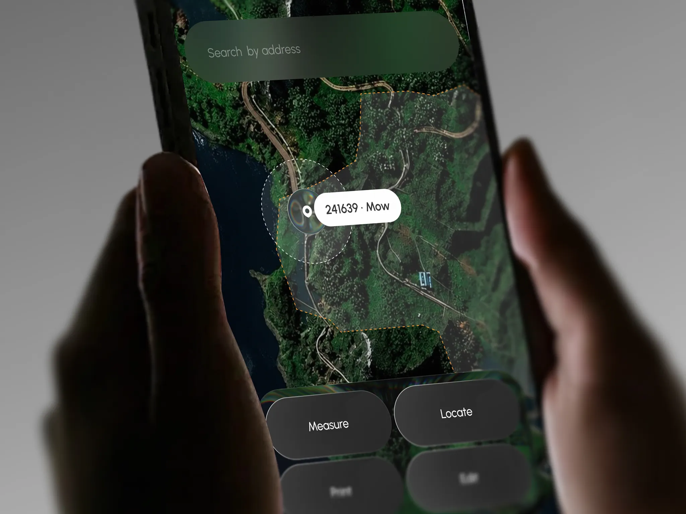

# Urbis｜真实地貌、任务标签和底部大操作区

来源：[Urbis - City Task Management Mobile App](https://dribbble.com/shots/27732220-Urbis-City-Task-Management-Mobile-App)；页面署名：RonDesignLab；查阅日期：2026-10-23。

本页为查阅当日的观察记录；下方提供随包图片，原作链接用于核对出处。

## 看到的设计

- 卫星地貌占据主体，任务区域有描边和半透明覆盖；选中位置由白色胶囊标题、中心标记和虚线圈共同强调。
- 上方搜索栏采用深绿灰底，底部操作为深色大圆角按钮组，控件都与地图形成前后关系。
- 白色任务标签与深色操作区各自保持形状清晰，细节丰富的地图仍作为背景。

## 可以怎么用

适合巡检、外勤和地点相关任务。重点学习选中对象清楚、常用操作在底部集中。

## 落地时要调整

不能照搬卫星地图的视觉密度到普通任务列表；户外屏幕、遮挡、定位误差与底部触达均需现场验证。

## 随包素材

[图 01](01.webp) · [图 02](02.webp) · [图 03](03.webp) · [图 04](04.webp) · [图 05](05.webp) · [图 06](06.webp)

## 来源与范围

本包保存观察笔记、原作链接及原始媒体，供跨设备查看；素材权利归原作者，不适用本仓 MIT 许可。查阅当日未发现公开的 Figma 或源码下载入口；静态展示及产品能力、增长数字不作为真实业务验证结果。具体颜色与实现参数需要按采用项目重新确定。

[返回作品索引](../../README.md) · [设计经验与复用指南](../../设计经验与复用指南.md)
