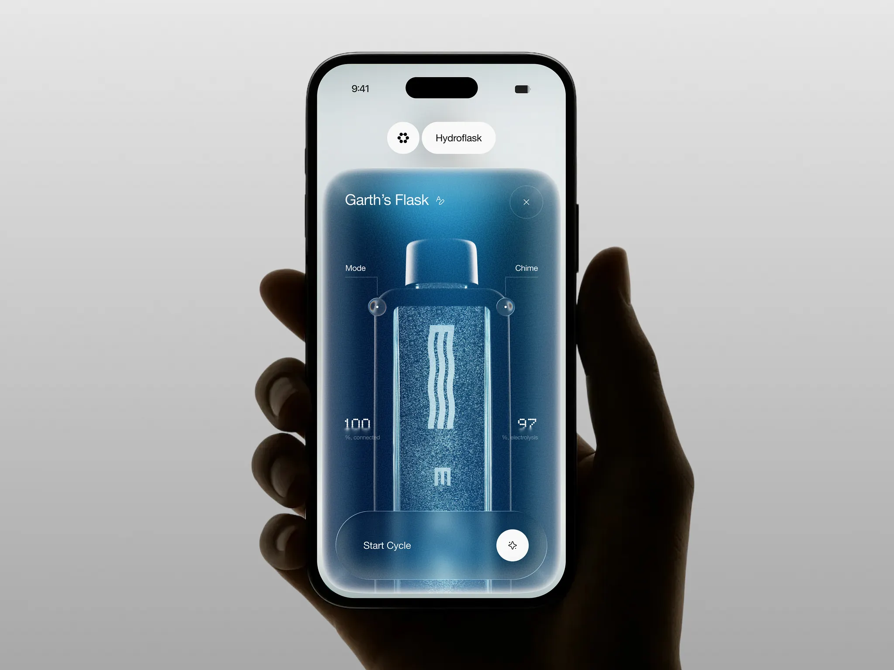

# Hydroflask｜蓝色颗粒材质、立体设备与单一主操作

来源：[Hydroflask - Smart Water Bottle Mobile App](https://dribbble.com/shots/27771706-Hydroflask-Smart-Water-Bottle-Mobile-App)；页面署名：Jack R. for RonDesignLab；查阅日期：2026-10-23。

本页为查阅当日的观察记录；下方提供随包图片，原作链接用于核对出处。

## 看到的设计

- 水瓶成为纵向视觉轴，顶部名称、两侧引导线、下方状态围绕实体安排；底部大胶囊容纳主操作和白色圆按钮。
- 蓝色深浅、边缘白色高光和颗粒共同形成材质感，图标与数字保持较简洁。
- 设备上两处圆形标记通过细虚线指向模式与提示音，具象物体与功能说明产生位置关联。

## 可以怎么用

适合设备控制、产品状态和品牌展示页。可学习“一个对象、一项状态、一个主操作”的聚焦方式。

## 落地时要调整

颗粒是图像材质观察，不能当作已知 CSS 实现。纯软件列表不必增加立体设备；热点位置、说明与点击区域要明确。

## 随包素材

[图 01](01.webp) · [图 02](02.webp) · [图 03](03.webp) · [图 04](04.webp) · [图 05](05.webp) · [图 06](06.webp) · [图 07](07.webp)

## 来源与范围

本包保存观察笔记、原作链接及原始媒体，供跨设备查看；素材权利归原作者，不适用本仓 MIT 许可。查阅当日未发现公开的 Figma 或源码下载入口；静态展示及产品能力、增长数字不作为真实业务验证结果。具体颜色与实现参数需要按采用项目重新确定。

[返回作品索引](../../README.md) · [设计经验与复用指南](../../设计经验与复用指南.md)
