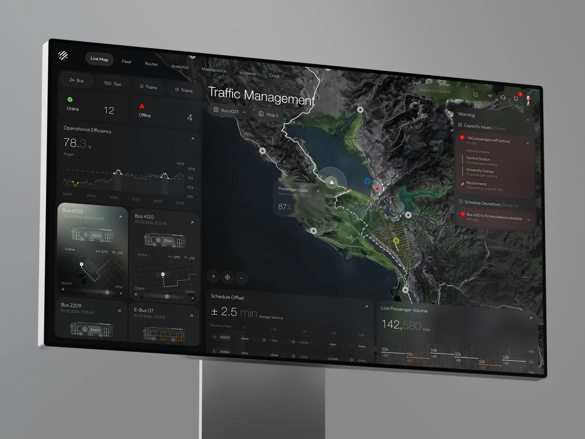

# Vexto｜地图中心、左侧对象列表和右侧异常处理

来源：[Vexto - Incident Response Desktop App](https://dribbble.com/shots/27619812-Vexto-Incident-Response-Desktop-App)；页面署名：RonDesignLab；查阅日期：2026-10-23。

本页为查阅当日的观察记录；下方提供随包图片，原作链接用于核对出处。

## 看到的设计

- 地形地图居中，左侧在线状态、趋势和车辆列表，右侧集中警告，底部补充运营数据，区域职责明确。
- 异常卡用暗红底与红色数量标记突出，选中路线和定位圈在地图上更亮；普通数据维持黑灰层次。
- 一张警告卡中包含问题、受影响地点与建议，详情与地图保持在同一屏。

## 可以怎么用

适合调度、监测和异常复盘。可以学习把异常信息放在固定可扫读区域，并让对象位置与详情联动。

## 落地时要调整

真实异常处理还需确认、责任人、进展和历史记录，静态图无法证明这些闭环；不能让背景细节或低对比字遮蔽高优先级信息。

## 随包素材

[图 01](01.webp) · [图 02](02.webp) · [图 03](03.webp) · [图 04](04.webp) · [图 05](05.webp) · [图 06](06.webp) · [图 07](07.webp)

## 来源与范围

本包保存观察笔记、原作链接及原始媒体，供跨设备查看；素材权利归原作者，不适用本仓 MIT 许可。查阅当日未发现公开的 Figma 或源码下载入口；静态展示及产品能力、增长数字不作为真实业务验证结果。具体颜色与实现参数需要按采用项目重新确定。

[返回作品索引](../../README.md) · [设计经验与复用指南](../../设计经验与复用指南.md)
